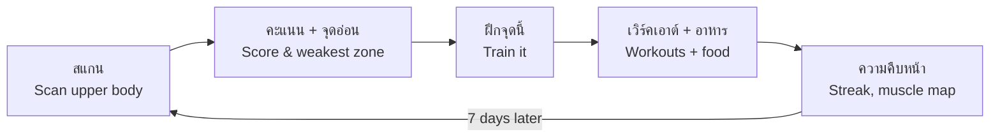
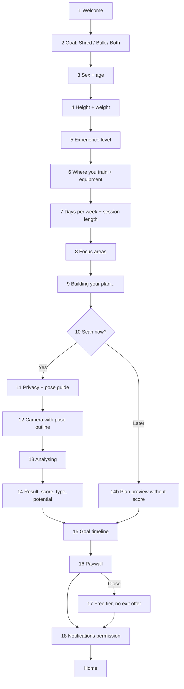
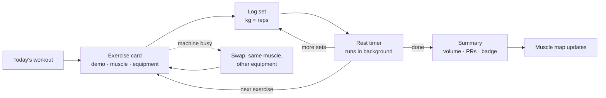
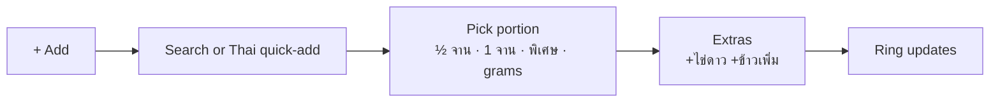

# GymMaxx — Design (UX/UI)

> Status: v0.1 draft · Platform: iOS + Android (one codebase) · Language: Thai first, English second

This document is the design source of truth for GymMaxx: who it is for, how users move through it, what every core screen does, and the visual system it is built with.

---

## 0. Decisions (v1)

| Topic | Decision |
|---|---|
| Visual style | **Dark premium** — black background, bold big numbers, one bright accent |
| Accent colour | **Electric blue** `#3A8BFF` |
| Main audience | **Mostly men** (Thai, beginners + gym-goers). Women's scan zones possible in a later version |
| Coach | **Voice coach "Maxx"** — Thai male voice, counts reps, can be muted |
| Home screen | **Today's workout first**, then streak, calories left, weakest zone |
| Paywall | **After the free score** — overall score + body type free, breakdown blurred |
| Body scan | **Front photo only** |
| Language | **Thai default + English toggle**; exercise names shown in both |

## 1. Product in one line

**"Whatever your starting point, GymMaxx shows you how to change your body — and lets you see it happen."**

GymMaxx is a Thai-first physique app. The user scans the upper body, gets a score per muscle zone, learns the one thing holding them back, and follows a plan (workouts + Thai food) built to fix it. A weekly re-scan shows progress.

## 2. Design principles

1. **One loop, always visible.** Scan → score → weakest zone → *Train it* → re-scan. Every screen points to the next action.
2. **Thai first.** Thai copy, Thai food with Thai portions, Thai-speaking coach. English is a toggle, not the default.
3. **Beginner clarity.** Every exercise answers three questions: *what muscle, what equipment, how to do it* — with a demo. No exercise ships without a demo.
4. **Progress vs. yourself, never vs. others.** No rankings, no shaming words. A low score is shown next to a *potential* score.
5. **Two goals, one app.** *Shred* (lose fat) and *Bulk* (gain muscle, for skinny users) share the same screens but change targets, wording and accent colour.
6. **Honest by default.** Discounts are calculated against prices the user has seen. Body-fat is a range. Photos are private.
7. **Works mid-workout.** Big tap targets, screen stays awake, timer keeps running in the background and on the lock screen.

## 3. Who it is for

| | **A · "Bulk" — skinny beginner** | **B · "Shred" — losing weight** | **C · Gym regular** (secondary) |
|---|---|---|---|
| Example | University student, 20, 175 cm / 56 kg | Office worker, 29, 170 cm / 84 kg | Trains 3–4×/week for 1+ year |
| Wants | Bigger shoulders, chest, arms | Lose the belly, see abs/arms | Track progress, break plateaus |
| Pain points | "ต้องกินกี่ cal ถึงจะ muscle ขึ้น", can't eat enough, scared of the gym | Slow scale, no idea what to eat, embarrassed to start | Bored of logging in Notes, no visual progress |
| Biggest fear | Looking clueless at a machine | Being judged for their body | Wasting time |
| Design response | Equipment guide, eat-more food tips, size-focused score | Optional/private scan, definition-focused score, kind copy | Fast logging, strength charts, physique score |

## 4. Core loop



Re-scan is limited to **once every 7 days** (countdown on the Scan tab). This creates a weekly ritual and keeps comparisons meaningful.

## 5. User journey

| Stage | User is thinking | Touchpoint | Feeling | Risk | Design response |
|---|---|---|---|---|---|
| **1. Discover** | "สแกนกล้ามได้กี่คะแนนนะ?" | TikTok slideshow / creator | Curious | Ad feels fake | Real Thai before/afters, honest claims |
| **2. Install & open** | "Is this another English app?" | Store page, splash | Unsure | Bounce | Thai screenshots, Thai first screen |
| **3. Onboarding** | "Get to the point" | 10–12 quick questions | Engaged → impatient | Too long (AbMaxx review: "took a while") | Progress bar, one tap per screen, ~90 seconds total |
| **4. First scan (aha)** | "What's my score?" | Camera + result | Excited / nervous | Low score → quits, body shame | Scan is optional; show *potential* next to score; kind body-type labels |
| **5. Paywall** | "Is this worth it?" | Paywall (close = free tier, no exit offer) | Sceptical | Fake discount → "scam" review | Price in ฿ with monthly equivalent, honest %, free tier still useful |
| **6. First workout** | "How do I use this machine?" | Workout player | Unsure → proud | Confusion, timer stops | Demo on every move, background timer, finish badge |
| **7. Week 1** | "Am I doing enough?" | Home, food log, streak | Motivated | Food logging friction | Thai quick-add with portions, daily target ring |
| **8. Week 2 re-scan** | "Did anything change?" | Compare view | Proud (or flat) | No visible change → churn | Show strength, waist and weight wins too, not only the photo score |
| **9. Month 1+** | "I'm actually changing" | Share card, phases | Confident | Plateau, boredom | New phase, new challenge, share card |

## 6. Onboarding

Target: **under 2 minutes to first score.** One question per screen, a progress bar, back button always available. Each answer visibly personalises something later ("เราจะใช้ข้อมูลนี้คำนวณแคลอรี่ของคุณ").



| # | Screen | Content / copy (TH) | Notes |
|---|---|---|---|
| 1 | Welcome | "เปลี่ยนหุ่นให้เห็นผล ไม่ว่าจะเริ่มจากตรงไหน" · [เริ่มเลย] · Sign in | Short looping clip of a Thai body transformation |
| 2 | Goal | "เป้าหมายของคุณคืออะไร?" · **ลดไขมัน ให้กล้ามชัด** (Shred) · **เพิ่มกล้าม เพิ่มน้ำหนัก** (Bulk) · **ลดไขมันและเพิ่มกล้ามไปพร้อมกัน** (Both) | Sets mode + accent colour for the whole app |
| 3 | Age | "อายุเท่าไหร่?" · iOS-style scroll wheel (18–80, starts at 25; GymMaxx is 18+ because of body photos), selection band in the centre | One question per screen; calorie maths |
| 4 | Height | "สูงเท่าไหร่?" · scroll wheel (140–210 cm) with segmented control ซม. / ฟุต-นิ้ว | |
| 4b | Weight | "น้ำหนักตอนนี้?" · big number + horizontal ruler you swipe (0.5 kg steps), segmented กก. / ปอนด์, mode-specific tip | |
| 5 | Experience | "เคยเล่นเวทมาก่อนไหม?" · ไม่เคยเลย · เคยบ้าง (ไม่ถึง 6 เดือน) · เล่นประจำ | Controls exercise difficulty |
| 6 | Where + equipment | ฟิตเนส / ที่บ้าน / ทั้งสองที่ → equipment checklist with icons (dumbbells, bench, cable, machines, pull-up bar, bands, none) | Feeds the "do with what we have" filter |
| 7 | Schedule | Days per week (2–6) · minutes per session (20 / 40 / 60) | |
| 8 | Focus areas | Tap zones on a body map: อก, ไหล่, แขน, หน้าท้อง, หลัง, ขา | Multi-select |
| 9 | Building plan | Animated checklist: "คำนวณแคลอรี่ ✓ เลือกท่าที่เหมาะกับอุปกรณ์ ✓ ..." | 3–4 s, builds anticipation |
| 10 | Scan prompt | "สแกนร่างกายเพื่อดูจุดแข็งและจุดที่ต้องพัฒนา" · [สแกนเลย] · [ไว้ทีหลัง] | **Skip is a first-class option** |
| 11 | Privacy + pose | "รูปของคุณจะถูกเก็บไว้ในเครื่องของคุณ ส่งไปวิเคราะห์แล้วลบทันที" · pose tips: same light, shirt off, arms relaxed at sides | PDPA consent checkbox |
| 12 | Camera | **One front photo**: body outline overlay (head to hips), distance indicator, 3-2-1 timer, retake button | Mirror selfie or propped phone both work |
| 13 | Analysing | Scanning line animation over the photo, zones lighting up | 3–5 s |
| 14 | Result (free) | Overall score (count-up) · body type label · potential score · body-fat range · zone breakdown **blurred** | The aha moment |
| 15 | Timeline | "~10 สัปดาห์ ถึงเป้าหมาย" + bottleneck (Shred: body fat · Bulk: calories eaten) | Personal, specific, motivating |
| 16 | Paywall | See §9 | |
| 17 | Exit offer | Shown once, honest % vs. the price on screen 16 | |
| 18 | Notifications | "ให้เราเตือนวันฝึกและวันสแกนไหม?" | Ask after value is shown |

## 7. Information architecture

Five tabs. Home sits in the centre.

| แผนฝึก (Plan) | อาหาร (Food) | **หน้าแรก (Home)** | สแกน (Scan) | ฉัน (Me) |
|---|---|---|---|---|
| This week's plan | Calories left ring | Today's workout card | Latest result | Profile + goal |
| Workout player | Protein / carbs / fat | Streak | Breakdown / Progress toggle | Body stats, weight log |
| Exercise library | Meals today | Calories left (mini) | Weekly re-scan countdown | Apple Health / Health Connect |
| Browse by muscle | Thai quick-add | Weakest zone + "Train it" | Compare week 1 vs now | Units, language, mode, coach voice |
| Browse by equipment | Eat-more tips (Bulk) | Challenges + Quick Hits (below the fold) | Share card | Subscription, privacy, delete data |

### Home layout (top to bottom)

```
🔥 12 วันติด                          (avatar)
┌──────────────────────────────────────┐
│ วันนี้: อก + ไหล่                      │
│ 6 ท่า · 40 นาที · ยิม                  │
│ [ ▶ เริ่มเลย ]          (blue, full)  │
└──────────────────────────────────────┘
อาหาร: เหลือ 1,240 kcal · โปรตีน 92/140 g
จุดอ่อน: ไหล่ 55 → [ฝึกเลย]
สแกนครั้งถัดไป: 3 วัน
── Challenges · Quick Hits ──
```

On rest days the workout card becomes "วันพัก" with a 10-minute mobility Quick Hit and the food card moves to the top.

## 8. Key flows

### 8.1 Workout (the user's own flow, refined)



- Coach "Maxx" counts reps and announces rest in Thai (voice can be muted).
- Previous session's numbers pre-fill each set; one tap = "same as last time".
- Screen stays awake; rest timer shows on the lock screen and as a notification.
- **Swap** keeps the target muscle and offers alternatives with the user's equipment.

### 8.2 Exercise lookup — answering the three beginner questions

| Question | Entry point | Result |
|---|---|---|
| "อยากได้กล้ามตัวนี้ ต้องทำท่าอะไร?" | Library → tap a muscle on the body map | Exercises for that muscle, filtered by the user's equipment |
| "อุปกรณ์นี้ทำท่าอะไรได้บ้าง?" | Library → Equipment grid | Exercises for that machine + which muscles they hit |
| "ท่านี้ได้กล้ามส่วนไหน?" | Any exercise card | Highlighted muscle map (primary / secondary) |

**Exercise card anatomy:** demo loop → name (TH + EN) → chips (level · equipment · target zone) → "ตรงกับจุดอ่อนของคุณ" tag when relevant → 3 numbered steps → 2 form cues → common mistake → muscle map → [เพิ่มในเวิร์คเอาต์].

### 8.3 Food log (Thai portions)



- Portion picker is mandatory and fast (the #1 AbMaxx complaint was "it assumes I ate the whole thing").
- Units: จาน, ถ้วย, ทัพพี, ช้อนโต๊ะ, ชิ้น, grams, ml.
- **Bulk mode** shows "เติมอีก 600 kcal ง่ายๆ" suggestions (e.g. นมจืด + กล้วย, ข้าวมันไก่ + ไข่).
- **Shred mode** shows lighter swaps (e.g. ข้าวกะเพรา → ขอข้าวครึ่งเดียว).

### 8.4 Scan result (front photo)

```
WEEK 1 · 1 SCAN                     ⏱ 6d 23h
สแกนร่างกาย         [ ความคืบหน้า | รายละเอียด ]
                  ( photo in blue ring )
                         64
               คะแนนรวม · ศักยภาพ 86
      ┌────────────────┬────────────────┐
      │ ผอมแต่มีพุง      │ ไขมัน 18–22%    │
      └────────────────┴────────────────┘
  อก (Chest)        62    ไหล่ (Shoulders) ● 55
  แขน (Arms)        60    หน้าท้อง (Abs)     58
  V-Taper          57    สมมาตร (Symmetry)  81
            [ ฝึกจุดอ่อน: ไหล่ → ]
```

Zones scored from the front photo: **chest, shoulders, arms, abs, V-taper** (shoulder-to-waist ratio) and **symmetry**. Back muscles are trained in the plan but not scored in v1. In Bulk mode the zone scores emphasise size; in Shred mode, definition. Free users see the overall score, body type, potential and body-fat range; zone scores are blurred until Pro.

### 8.5 Weekly re-scan

Countdown ends → push notification → same pose outline as week 1 (ghost overlay of last photo) → result with deltas per zone (▲ +3) → Progress tab shows week 1 vs now side by side → optional share card (photo can be blurred or hidden; scores only).

## 9. Paywall & pricing UX

| Free | Pro |
|---|---|
| First scan: overall score, body type, potential | Full zone breakdown + weakest zone |
| Exercise library **with all demos** | Personalised weekly plan that adapts |
| Workout logger + timer | Weekly re-scan + compare + share cards |
| Calorie & protein target, basic food log | Coach voice, challenges, Thai eat-more / swap tips |

Rules:
- Prices in **฿** with the monthly equivalent ("≈ ฿99/เดือน").
- Any "% off" is calculated against a price shown on the same or previous screen.
- No exit offer: closing the paywall goes straight to the free tier. No fake countdowns. The auto-renew price and how to cancel are always shown above the button (App Store 3.1.2).
- Cancel instructions are one tap away in Me → Subscription.
- Prices are hypotheses to test (e.g. ฿199/month, ฿1,190/year).

## 10. Visual design system

### 10.0 Update — iOS-native (supersedes 10.2–10.4 where they differ)

After prototype review the UI moves to **iOS-native patterns** (Human Interface Guidelines):

- **Type:** the system font: SF Pro and *Sukhumvit Set* for Thai on iPhone, Roboto and Noto Sans Thai on Android, Noto Sans Thai as the web fallback. Numbers use SF Pro Rounded (`ui-rounded`), with Nunito as the fallback. Large titles are 32–34 pt bold, body text 17 pt, footnotes 13 pt.
- **Colour:** Apple's dark system palette: background `#000000`, grouped surfaces `#1C1C1E` and `#2C2C2E`, separators `#38383A`, secondary text `#A1A1AA`. Blue `#3A8BFF` stays the accent, and filled buttons stay `#2563EB` with white text. Semantic colours use iOS system values: green `#30D158`, yellow `#FFD60A`, red `#FF453A`. Mode colours are Shred orange `#FF9F0A`, Bulk purple `#BF5AF2` and Recomp blue.
- **Components:**
  - navigation bar with a "‹ ย้อนกลับ" back button and a large title underneath
  - grouped inset lists with inset separators, not bordered cards
  - iOS switches for on/off settings
  - segmented controls (grey selected pill)
  - scroll-wheel pickers for age and height, and a horizontal ruler for weight
  - bottom sheets with a grabber
  - slide transitions between onboarding steps
- **Onboarding in 19 steps, one question per screen:** welcome → goal → results insight (with vs without GymMaxx) → age → height → weight → experience → where you train → equipment → **days per week (asked as a count; the app picks the days, which can be changed on the plan screen)** → minutes per session → nickname → building-your-plan loader → plan reveal (timeline) → projected progress chart (titles by goal: "มวลกล้ามเนื้อเพิ่มขึ้น" (more muscle mass) for muscle gain; "คาดว่าน้ำหนักจะลดลง" (weight is expected to drop) for fat loss and for health; "ไขมันลดลง กล้ามเนื้อเพิ่มขึ้น" (less fat, more muscle) for recomp; "หุ่นกระชับขึ้น น้ำหนักคงที่" (more toned, same weight) when a fat-loss user is already slim; the second line, in blue, reads "ภายใน 14 ม.ค." (by 14 Jan)). The chart compares two lines over 84 days, AbMaxx-style:
  - **กับ GymMaxx (with GymMaxx):** a solid blue wavy line with a dot at each scan checkpoint and a blue gradient fill underneath
  - **ฝึกเอง (on your own):** a red dashed line that barely moves (about 18% of the change)
  - each line has its own label pill; the y-axis is "ความคืบหน้าสู่เป้าหมาย" (progress to goal), so the blue line always rises whatever the goal (as in AbMaxx), and the kilograms appear in the pill below
  - below the chart: two pills (⚡ weight change, 📅 84 วัน / 84 days) and a one-line caption → scan intro → camera → result → paywall. Never combine questions on one screen.
- **Results insight (step 3, after goal):**
  - a title that depends on the goal, e.g. "กล้ามขึ้นเห็นผลเร็วขึ้น 2 เท่า กับ GymMaxx เทียบกับฝึกเอง" (see muscle gains 2× faster with GymMaxx than on your own)
  - a card with two bars that grow upward: "ฝึกเอง" (on your own) is a short grey bar at 1X; "กับ GymMaxx" (with GymMaxx) is a tall blue bar at 2X, drawn at true 2:1 scale
  - a one-line caption saying why (scan finds the weak spot, targeted exercises and Thai food, staying consistent)
  - **the "2X" figure is a placeholder. Before launch, back it with our own data (e.g. score gain per week for active users vs a baseline) or replace it with a claim we can prove. App Store rules and Thai consumer-protection advertising rules require that.**
- **Option rows:** an icon, a title and a one-line description, with a radio on the right. The whole row turns solid blue when selected. The Continue pill stays disabled until the user picks. Goals use plain words, not jargon: "ลดพุง ลดไขมัน" (lose belly, lose fat), "เพิ่มกล้าม ตัวใหญ่ขึ้น" (build muscle, get bigger), "ลดไขมัน และเพิ่มกล้าม" (lose fat and build muscle), "แข็งแรงขึ้น สุขภาพดี" (get stronger, be healthier). The plan for that goal is called "แผนฟิตหุ่นของ…" (…'s fit-body plan).
- **Equipment:** **real photos** in a list, grouped like a gym is laid out: small weights · bars & plates · benches & racks · cables & machines · bands. Group names are large bold headers. Each row shows a square **equipment-only image** (just the item on a light tile, no person, like Fitbod; the prototype uses the SVG illustrations in `design/equipment/`), the Thai name, the English name with a one-line explanation, and a checkbox. Tabs: ยอดนิยม (popular) / ทั้งหมด (all) / เลือกแล้ว (selected), plus "select all" per group. A **"ค้นหาอุปกรณ์" (search equipment)** pill sits above the Continue button, like Fitbod. It opens a full-screen search with a text field and a category list (icon, name, how many are selected, chevron). Tapping a category opens its items with "select all". Typing matches Thai names, English names and nicknames (e.g. "bench", "ดัมเบล", "lat pulldown"). If nothing matches, it suggests trying the English name or browsing by category. Next to search, **"ไม่แน่ใจ? เลือกให้" (not sure? pick for me)** fills in the popular set for where they train and moves on. At a gym that's most machines, at home it's dumbbells and a band. The plan screen then says the equipment was picked for them and can be changed in the profile. Gym users start with everything ticked; home users start empty.
- **Main app tabs:** a **floating pill tab bar** (inset 12 px from the screen edges, 18 px from the bottom) holding หน้าแรก (Home) · ฝึก (Train) · อาหาร (Food) · ผลสแกน (Scan results, same word as that screen's title). The selected tab gets a soft filled pill. **Scan is a separate round 64 px button to the right of the pill**, so it's always one tap away. The profile sits behind the avatar on Home.
- **Theme:** dark is the default. Every screen also supports light (Cal AI-like: off-white `#F4F3F7` ground, white cards with a soft shadow, near-black text, a black scan button) through the same tokens (`.gx.light`). Users pick มืด (dark) / สว่าง (light) / ตามเครื่อง (follow phone) in Profile, and the choice applies everywhere at once. The camera always stays dark.
- **Home, top to bottom:**
  - GymMaxx wordmark + **streak pill** (flame + days). Tapping it opens a streak sheet with this week's flames, the best streak, and the rule: train or log food once a day.
  - Week strip: done days get an orange ring, today a white ring.
  - **Today's workout card with a big "เริ่มออกกำลังกาย" (start workout) button, always the first thing on screen.**
  - Swipeable pages with dots (Cal AI pattern):
    - page 1: calories-left card (big number, ring with a flame) and three macro-left cards, each with an icon in its ring (protein violet `#A78BFA`, carbs teal `#2DD4BF`, fat pink `#F472B6`; macro colours never reuse warning red, streak orange or action blue). These macro colours are used everywhere (Home, Food, scan results). When a macro goes over target, the card says "เกิน" (over) with the amount instead of showing 0.
    - page 2: body score and weight
  - Recent activity.
  - There's no date header; the week strip does that job.
- **Scan (center tab):** one camera for everything.
  - Modes are icon tiles above the shutter (Cal AI pattern). Default mode is **"AI อัตโนมัติ" (AI auto)**: the AI detects whether it's looking at food, a body or a barcode and says so before you shoot. Manual modes: อาหาร (food) · ร่างกาย (body) · บาร์โค้ด (barcode).
  - If a manual mode doesn't match what's in frame, the app offers to switch.
  - **Food result:** dish name, AI confidence, kcal, P/C/F, a portion picker and a "บันทึกมื้อนี้" (log this meal) button, which adds it to Food.
  - **Body result:** the new score and change, plus "ดูผลละเอียด" (see full results), which goes to Progress.
- **Scan result / Analysis (AbMaxx structure):** this layout is used both for the first scan at the end of onboarding and for the Progress tab.
  - header: "WEEK n · n สแกน" eyebrow, large title "ผลวิเคราะห์" (analysis), and a pill showing the time until the next scan (e.g. 6d 23h)
  - segmented control ความคืบหน้า (progress) | รายละเอียด (breakdown); the selected side is solid blue
  - breakdown card, top to bottom:
    - circular scan photo with a blue ring filled to the score
    - big overall score and "คะแนนรวม" (overall score)
    - two stats with a divider: body type, body-fat %
    - 2-column zone grid: label, colour-coded score and bar; a red dot marks the weakest zone
  - "วิเคราะห์กล้ามเนื้อ" (muscle analysis) card: front and back body maps coloured by score, with a legend for weak <60, developing 60–79, good 80+
  - in onboarding the zone grid is blurred behind "คะแนน 6 ส่วน และจุดอ่อน" (6 zone scores and weak spot) until they subscribe; the progress side explains that the chart starts after the second scan
- **Progress:** the streak and badges cards now sit at the top of the progress side.
- **Food (calorie-tracker style):** big calories-left number with a ring, macro-left cards with rings, a coach tip, "สแกนอาหาร" (scan food) / "เลือกเมนูไทย" (pick a Thai dish), and today's log with dish thumbnails, time, kcal and an "สแกน AI" (AI scan) tag.
- **Workout player:** an overview with a big elapsed timer → a logging screen per exercise (demo header, reps and kg input boxes, "log set") → a rest bottom sheet (−10/+10, pause, done) → a finish screen with confetti, trained muscles, PRs and a share card.
- **Onboarding is one flow with shared state.** Answers feed the plan summary (calories, protein, weekly split) and the scan result (body type, body-fat range, timeline). They're saved on finish so Home and Food use the same targets. Tapping a summary row jumps back to edit that answer.

### 10.0b Audit fixes (Oct 2026) — rules that now apply everywhere

**Trust and legal**
- **18+ only.** Age wheel starts at 18. Body photos of minors are out of scope.
- **Body photo you can take alone.** Scan intro adds "พิงมือถือกับผนัง ถอยหลัง 2 ก้าว" (lean the phone on a wall, step back 2 paces). The camera first checks pose and light (amber) before showing ready (green). It has a 3 / 5 / 10 s timer (default 10) with a voice countdown. Body scans from the Scan tab use the same 10 s countdown.
- **We only score what the camera sees.** The front photo scores front zones. The back map shows "เพิ่มรูปด้านหลัง" (add a back photo) until a back photo exists.
- **Every estimate links to "วิธีคำนวณ" (how we calculate).** This covers the 2X insight, the projection chart, the score and body fat ("ไขมัน (ประมาณ)", ±4%). The 2X stays a placeholder until real cohort data replaces it.
- **Consent is a real checkbox** with plain wording and a policy link, plus "ใส่เสื้อรัดรูปได้" (a fitted shirt is fine).
- **Profile** (from the Home avatar):
  - edit goal, days, minutes, place and equipment
  - weight units; notifications; theme
  - subscription (auto-renew date, how to cancel), restore purchase
  - how scores are calculated
  - download my data, delete scan photos, delete account (within 30 days, PDPA)

**Flows**
- **Progress bar** covers the whole onboarding flow, so it no longer fills up early.
- **Streak:** training *or* logging food counts. Today with meals logged shows as done. A finished workout doesn't add a second day.
- **One week strip everywhere** (Home, Train, streak sheet):
  - done = orange ring
  - missed = dashed
  - future = faint
  - today = raised
  - blue dot = planned workout day
  - legend in the streak sheet and on Train
- **Home vs Train:** Home starts today's workout. Train ("แผนสัปดาห์นี้", this week's plan) owns the week: 7-day schedule (done / today / rest), today's exercises with swap, and the library. Library muscle groups use exercise photos, not body-map icons.
- **Workout logging:**
  - big −/+ steppers for reps and kg (±2.5 kg); no free-text inputs
  - "ข้ามเซ็ตนี้" (skip set) replaces "log all sets"
  - Maxx speaks in one line
  - overview's primary button is "เริ่ม / ทำต่อ: <next exercise>" (start / continue); ending early is a secondary link with a confirmation sheet
  - the close button is neutral, not red
- **Food:**
  - "ค้นหาเมนู" (search dishes) with recent / favourite / all tabs, Thai and English search, ~25 Thai dishes
  - tap a logged meal to change the portion or delete it
  - scan results offer "ไม่ใช่เมนูนี้?" (not this dish?) with similar dishes and a search link
- **Empty and error states:**
  - first-day Home (HomeNew board): 0 streak, full calories, "สแกนมื้อแรก" (scan your first meal), notification card leading to a pre-permission sheet (max 2 a day)
  - empty food log
  - failed scan (dark or blurry, with tips)
  - offline (photo kept, analysed when back online)

**Visual**
- **No letter-spacing on Thai.** `.gx-eyebrow` is 0; Latin-only labels add `.gx-latin`.
- **Floating tab bar** has a fade behind it, so content never shows around it. Inactive labels use `--t2` for contrast.
- **Chip rows wrap**, never clip.
- **Copy and units:**
  - "แคลอรี" (not แคลอรี่), "เวิร์กเอาต์"
  - numbers + "kcal"; grams "20 ก." with a space; kg "กก."
  - Thai dates and durations ("สัปดาห์ที่ 3", "อีก 3 วัน 4 ชม."); no "WEEK" or "3d 4h"
  - plain words instead of jargon ("กก. ที่ยกรวม" total kg lifted, "ยกหนักขึ้น" lifted heavier, "เป้าวันนี้ 2,750 kcal" today's target 2,750 kcal)
- **Accessibility:** `--t3` raised to `#8A909B` (dark) / `#6E6E78` (light) so small text passes 4.5:1. Tap targets ≥ 44 pt.
- **Dynamic Type in the app:** the prototype uses fixed px. The app must map sizes to iOS text styles / Android sp, and layouts must reflow at the largest accessibility size.

### 10.1 Direction

Dark, premium, energetic — the "maxxing" look users expect. Electric blue is the single action colour. Because AbMaxx also uses blue, GymMaxx sets itself apart through Thai copy, Thai male models at mixed fitness levels (not only shredded), rounded shapes and the Kanit display font.

### 10.2 Colour tokens (dark theme, v1 is dark-only)

```css
:root {
  /* surfaces */
  --bg:            #0B0B0D;
  --surface-1:     #16171A;
  --surface-2:     #1F2125;
  --border:        #2A2D32;

  /* text */
  --text:          #F5F5F7;
  --text-muted:    #9BA1A8;
  --text-faint:    #63686F;

  /* brand / actions */
  --accent:        #3A8BFF;  /* electric blue — links, active tab, rings, highlights on dark */
  --primary:       #2563EB;  /* button fill (deeper blue so white text passes AA) */
  --on-primary:    #FFFFFF;
  --primary-press: #1D4ED8;

  /* goal modes (badges and timeline only, never buttons) */
  --mode-shred:    #FF8A3A;  /* orange — Shred */
  --mode-bulk:     #A78BFA;  /* violet — Bulk */

  /* score scale */
  --score-high:    #34D399;  /* ≥ 80 */
  --score-mid:     #FBBF24;  /* 60–79 */
  --score-low:     #F87171;  /* < 60, also "weakest zone" dot */
}
```

Text on `--bg` and `--surface-1` must meet WCAG AA (4.5:1). `#3A8BFF` on `--bg` passes (≈ 5.9:1), but white text on `#3A8BFF` does not (≈ 3.3:1) — so filled buttons use `--primary` `#2563EB` (≈ 5.2:1 with white). Score colour is never the only signal — always paired with the number.

### 10.3 Typography

| Role | Font | Size / weight |
|---|---|---|
| Display (screen titles, marketing) | **Kanit** | 32–40 / 700, uppercase for Latin |
| Big numbers (scores, timers, kcal) | **Barlow Condensed** | 56–96 / 700, tabular numerals |
| Headings | Kanit | 20–24 / 600 |
| Body | **IBM Plex Sans Thai** | 15–17 / 400, line-height 1.6 |
| Labels / chips | IBM Plex Sans Thai | 12–13 / 500, letter-spacing +2% |

All three are free Google Fonts with full Thai support (Barlow is Latin, used only for numerals). Thai has no spaces between words — use proper Thai line breaking and never truncate Thai mid-word.

### 10.4 Layout & shape

- 4-pt spacing grid; screen padding 20; card padding 16.
- Radius: chips 999, buttons 16, cards 20, sheets 28.
- Minimum tap target 48×48 (sweaty hands mid-workout).
- Primary button full-width, bottom of screen, within thumb reach.

### 10.5 Core components

Button (primary / secondary / ghost) · Chip · Card · Score ring · Zone score bar · Muscle map (anatomical front/back male body from react-native-body-highlighter, MIT — grey silhouette, each muscle coloured by state: primary/secondary for exercises, score colour for scans, trained-today on summaries) · Exercise card · Set row (kg × reps, ✓) · Rest timer · Macro ring · Food item + portion picker · Streak flame · Badge · Countdown pill · Paywall plan card · Bottom sheet · Toast.

### 10.6 Motion & feedback

- Score count-up (0 → score, 1.2 s, ease-out) with a soft haptic at the end.
- Scan line sweep + zones lighting up in sequence.
- Set completed: check + light haptic. Workout finished: badge pop + success haptic.
- Respect the OS "reduce motion" setting.

### 10.7 Imagery

- Exercise demos: free-exercise-db start/end photos as a looping 2-frame animation for v1; licensed GIFs or reviewed AI clips later (see research notes).
- Avoid only shredded models. Show a range of Thai male bodies — skinny, skinny-fat, overweight beginners — not only athletes.
- Icons: one consistent outline set (e.g. Lucide or Phosphor), 24 px, 1.75 stroke.

## 11. Voice & copy

Tone: a friendly gym buddy — casual Thai (เป็นกันเอง), encouraging, never preachy or shaming.

| Avoid | Use |
|---|---|
| อ้วน (fat) | ไขมันสะสม / มีไขมันมากกว่าเป้าหมาย |
| คะแนนต่ำ (low score) | ยังมีพื้นที่ให้พัฒนาอีกเยอะ |
| You failed your streak | ไม่เป็นไร เริ่มใหม่วันนี้ได้เลย |

Body-type labels: **ผอม** (Skinny) · **ผอมแต่มีพุง** (Skinny-fat) · **สมส่วน** (Lean) · **ทรง V** (V-Shape) · **ไขมันสะสม** (Higher body fat).

### Coach "Maxx"

- Thai male voice (pre-generated TTS clips, so it works offline); English voice when the app language is English.
- Personality: big-brother gym buddy — warm, upbeat, uses the user's nickname, never yells or insults.
- Speaks at: workout start, each rep count (optional), last 3 reps, rest start / 10 s left, new PR, workout finished.
- Settings: voice on / off, rep counting on / off, volume ducks music instead of stopping it.

Sample lines: "พร้อมยัง? เดี๋ยวนับให้ทุกครั้ง" · "อีก 3 ครั้ง!" · "พัก 90 วินาที ดื่มน้ำก่อน" · "เหลือ 10 วิ เตรียมตัว" · "สถิติใหม่! เก่งมาก" · "จุดอ่อนวันนี้คือไหล่ ไปลุยกัน".

## 12. Accessibility, localisation, privacy

- Thai ↔ English toggle; dynamic type up to 200% without clipping.
- Units: kg/cm default; lb/in optional.
- VoiceOver / TalkBack labels on every score and chart.
- Body photos: stored on device; sent for analysis over TLS and deleted server-side after scoring; explicit PDPA consent; "Delete all my photos" in Me → Privacy.
- Calorie targets have a safe floor and a max weekly loss rate; no extreme-deficit plans.

## 13. What to measure

| Stage | Metric |
|---|---|
| Onboarding | Completion rate, time to first score |
| Scan | % who scan in onboarding, % who skip and scan later |
| Paywall | Trial start / purchase rate, exit-offer take rate, refund rate |
| Activation | % completing first workout within 48 h |
| Retention | D1 / D7 / D30, week-2 re-scan rate |
| Nutrition | Days with ≥ 2 meals logged per week |

## 14. Next steps

1. Low-fi wireframes of the 18 onboarding screens + 5 tabs.
2. Clickable prototype (Thai) of: onboarding → scan result → home → workout player → food log.
3. Test with 5 Bulk and 5 Shred Thai beginners: can they finish onboarding, understand their score, and log a workout without help?
4. Iterate, then build in React Native (Expo).
