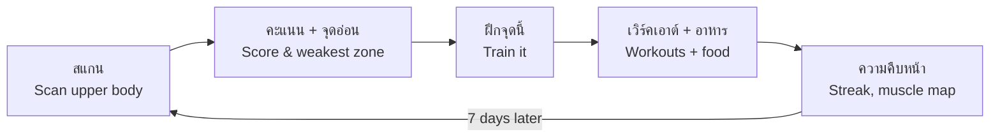
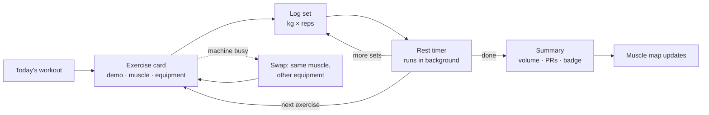
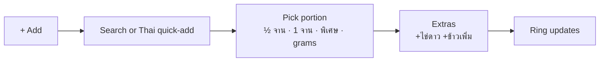

# GymMaxx — Design (UX/UI)

> Status: v0.1 draft · Platform: iOS + Android (one codebase) · Language: Thai first, English second

This document is the design source of truth for GymMaxx: who it is for, how users move through it, what every core screen does, and the visual system it is built with.

---

## 1. Product in one line

**"Whatever your starting point, GymMaxx shows you how to change your body — and lets you see it happen."**

GymMaxx is a Thai-first physique app. The user scans the upper body, gets a score per muscle zone, learns the one thing holding them back, and follows a plan (workouts + Thai food) built to fix it. A weekly re-scan shows progress.

## 2. Design principles

1. **One loop, always visible.** Scan → score → weakest zone → *Train it* → re-scan. Every screen points to the next action.
2. **Thai first.** Thai copy, Thai food with Thai portions, Thai-speaking coach. English is a toggle, not the default.
3. **Beginner clarity.** Every exercise answers three questions: *what muscle, what equipment, how to do it* — with a demo. No exercise ships without a demo.
4. **Progress vs. yourself, never vs. others.** No rankings, no shaming words. A low score is shown next to a *potential* score.
5. **Two goals, one app.** *Shred* (lose fat) and *Bulk* (gain muscle, for skinny users) share the same screens but change targets, wording and accent colour.
6. **Honest by default.** Discounts are calculated against prices the user has seen. Body-fat is a range. Photos are private.
7. **Works mid-workout.** Big tap targets, screen stays awake, timer keeps running in the background and on the lock screen.

## 3. Who it is for

| | **A · "Bulk" — skinny beginner** | **B · "Shred" — losing weight** | **C · Gym regular** (secondary) |
|---|---|---|---|
| Example | University student, 20, 175 cm / 56 kg | Office worker, 29, 170 cm / 84 kg | Trains 3–4×/week for 1+ year |
| Wants | Bigger shoulders, chest, arms | Lose the belly, see abs/arms | Track progress, break plateaus |
| Pain points | "ต้องกินกี่ cal ถึงจะ muscle ขึ้น", can't eat enough, scared of the gym | Slow scale, no idea what to eat, embarrassed to start | Bored of logging in Notes, no visual progress |
| Biggest fear | Looking clueless at a machine | Being judged for their body | Wasting time |
| Design response | Equipment guide, eat-more food tips, size-focused score | Optional/private scan, definition-focused score, kind copy | Fast logging, strength charts, physique score |

## 4. Core loop



Re-scan is limited to **once every 7 days** (countdown on the Scan tab). This creates a weekly ritual and keeps comparisons meaningful.

## 5. User journey

| Stage | User is thinking | Touchpoint | Feeling | Risk | Design response |
|---|---|---|---|---|---|
| **1. Discover** | "สแกนกล้ามได้กี่คะแนนนะ?" | TikTok slideshow / creator | Curious | Ad feels fake | Real Thai before/afters, honest claims |
| **2. Install & open** | "Is this another English app?" | Store page, splash | Unsure | Bounce | Thai screenshots, Thai first screen |
| **3. Onboarding** | "Get to the point" | 10–12 quick questions | Engaged → impatient | Too long (AbMaxx review: "took a while") | Progress bar, one tap per screen, ~90 seconds total |
| **4. First scan (aha)** | "What's my score?" | Camera + result | Excited / nervous | Low score → quits, body shame | Scan is optional; show *potential* next to score; kind body-type labels |
| **5. Paywall** | "Is this worth it?" | Paywall + one exit offer | Sceptical | Fake discount → "scam" review | Price in ฿ with monthly equivalent, honest %, free tier still useful |
| **6. First workout** | "How do I use this machine?" | Workout player | Unsure → proud | Confusion, timer stops | Demo on every move, background timer, finish badge |
| **7. Week 1** | "Am I doing enough?" | Home, food log, streak | Motivated | Food logging friction | Thai quick-add with portions, daily target ring |
| **8. Week 2 re-scan** | "Did anything change?" | Compare view | Proud (or flat) | No visible change → churn | Show strength, waist and weight wins too, not only the photo score |
| **9. Month 1+** | "I'm actually changing" | Share card, phases | Confident | Plateau, boredom | New phase, new challenge, share card |

## 6. Onboarding

Target: **under 2 minutes to first score.** One question per screen, a progress bar, back button always available. Each answer visibly personalises something later ("เราจะใช้ข้อมูลนี้คำนวณแคลอรี่ของคุณ").


| # | Screen | Content / copy (TH) | Notes |
|---|---|---|---|
| 1 | Welcome | "เปลี่ยนหุ่นให้เห็นผล ไม่ว่าจะเริ่มจากตรงไหน" · [เริ่มเลย] · Sign in | Short looping clip of a Thai body transformation |
| 2 | Goal | "เป้าหมายของคุณคืออะไร?" · **ลดไขมัน ให้กล้ามชัด** (Shred) · **เพิ่มกล้าม เพิ่มน้ำหนัก** (Bulk) · **ลดไขมันและเพิ่มกล้ามไปพร้อมกัน** (Both) | Sets mode + accent colour for the whole app |
| 3 | Sex + age | Two pickers | Needed for calorie maths |
| 4 | Height + weight | Wheel pickers, cm / kg | |
| 5 | Experience | "เคยเล่นเวทมาก่อนไหม?" · ไม่เคยเลย · เคยบ้าง (ไม่ถึง 6 เดือน) · เล่นประจำ | Controls exercise difficulty |
| 6 | Where + equipment | ฟิตเนส / ที่บ้าน / ทั้งสองที่ → equipment checklist with icons (dumbbells, bench, cable, machines, pull-up bar, bands, none) | Feeds the "do with what we have" filter |
| 7 | Schedule | Days per week (2–6) · minutes per session (20 / 40 / 60) | |
| 8 | Focus areas | Tap zones on a body map: อก, ไหล่, แขน, หน้าท้อง, หลัง, ขา | Multi-select |
| 9 | Building plan | Animated checklist: "คำนวณแคลอรี่ ✓ เลือกท่าที่เหมาะกับอุปกรณ์ ✓ ..." | 3–4 s, builds anticipation |
| 10 | Scan prompt | "สแกนร่างกายเพื่อดูจุดแข็งและจุดที่ต้องพัฒนา" · [สแกนเลย] · [ไว้ทีหลัง] | **Skip is a first-class option** |
| 11 | Privacy + pose | "รูปของคุณจะถูกเก็บไว้ในเครื่องของคุณ ส่งไปวิเคราะห์แล้วลบทันที" · pose tips: same light, shirt off or tight top, arms relaxed | PDPA consent checkbox |
| 12 | Camera | Body outline overlay, distance indicator, 3-2-1 timer, front photo (back photo optional, unlocks lats/V-taper) | |
| 13 | Analysing | Scanning line animation over the photo, zones lighting up | 3–5 s |
| 14 | Result (free) | Overall score (count-up) · body type label · potential score · body-fat range · zone breakdown **blurred** | The aha moment |
| 15 | Timeline | "~10 สัปดาห์ ถึงเป้าหมาย" + bottleneck (Shred: body fat · Bulk: calories eaten) | Personal, specific, motivating |
| 16 | Paywall | See §9 | |
| 17 | Exit offer | Shown once, honest % vs. the price on screen 16 | |
| 18 | Notifications | "ให้เราเตือนวันฝึกและวันสแกนไหม?" | Ask after value is shown |

## 7. Information architecture

Five tabs. Home sits in the centre.

| แผนฝึก (Plan) | อาหาร (Food) | **หน้าแรก (Home)** | สแกน (Scan) | ฉัน (Me) |
|---|---|---|---|---|
| This week's plan | Calories left ring | Today's workout card | Latest result | Profile + goal |
| Workout player | Protein / carbs / fat | Streak + badges | Breakdown / Progress toggle | Body stats, weight log |
| Exercise library | Meals today | Challenges (21/30-day) | Weekly re-scan countdown | Apple Health / Health Connect |
| Browse by muscle | Thai quick-add | Quick Hits (<15 min) | Compare week 1 vs now | Units, language, mode |
| Browse by equipment | Eat-more tips (Bulk) | Bottleneck + "Train it" | Share card | Subscription, privacy, delete data |

## 8. Key flows

### 8.1 Workout (the user's own flow, refined)



- Coach "Maxx" counts reps and announces rest in Thai (voice can be muted).
- Previous session's numbers pre-fill each set; one tap = "same as last time".
- Screen stays awake; rest timer shows on the lock screen and as a notification.
- **Swap** keeps the target muscle and offers alternatives with the user's equipment.

### 8.2 Exercise lookup — answering the three beginner questions

| Question | Entry point | Result |
|---|---|---|
| "อยากได้กล้ามตัวนี้ ต้องทำท่าอะไร?" | Library → tap a muscle on the body map | Exercises for that muscle, filtered by the user's equipment |
| "อุปกรณ์นี้ทำท่าอะไรได้บ้าง?" | Library → Equipment grid | Exercises for that machine + which muscles they hit |
| "ท่านี้ได้กล้ามส่วนไหน?" | Any exercise card | Highlighted muscle map (primary / secondary) |

**Exercise card anatomy:** demo loop → name (TH + EN) → chips (level · equipment · target zone) → "ตรงกับจุดอ่อนของคุณ" tag when relevant → 3 numbered steps → 2 form cues → common mistake → muscle map → [เพิ่มในเวิร์คเอาต์].

### 8.3 Food log (Thai portions)



- Portion picker is mandatory and fast (the #1 AbMaxx complaint was "it assumes I ate the whole thing").
- Units: จาน, ถ้วย, ทัพพี, ช้อนโต๊ะ, ชิ้น, grams, ml.
- **Bulk mode** shows "เติมอีก 600 kcal ง่ายๆ" suggestions (e.g. นมจืด + กล้วย, ข้าวมันไก่ + ไข่).
- **Shred mode** shows lighter swaps (e.g. ข้าวกะเพรา → ขอข้าวครึ่งเดียว).

### 8.4 Weekly re-scan

Countdown ends → push notification → same pose outline as week 1 (ghost overlay of last photo) → result with deltas per zone (▲ +3) → Progress tab shows week 1 vs now side by side → optional share card (photo can be blurred or hidden; scores only).

## 9. Paywall & pricing UX

| Free | Pro |
|---|---|
| First scan: overall score, body type, potential | Full zone breakdown + weakest zone |
| Exercise library **with all demos** | Personalised weekly plan that adapts |
| Workout logger + timer | Weekly re-scan + compare + share cards |
| Calorie & protein target, basic food log | Coach voice, challenges, Thai eat-more / swap tips |

Rules:
- Prices in **฿** with the monthly equivalent ("≈ ฿99/เดือน").
- Any "% off" is calculated against a price shown on the same or previous screen.
- One exit offer, once. No fake countdowns.
- Cancel instructions are one tap away in Me → Subscription.
- Prices are hypotheses to test (e.g. ฿199/month, ฿1,190/year).

## 10. Visual design system

### 10.1 Direction

Dark, premium, energetic — the "maxxing" look users expect — but warmer and less intimidating than AbMaxx: real Thai bodies at mixed fitness levels, rounded shapes, friendly copy.

### 10.2 Colour tokens (dark theme, v1 is dark-only)

```css
:root {
  /* surfaces */
  --bg:            #0B0B0D;
  --surface-1:     #16171A;
  --surface-2:     #1F2125;
  --border:        #2A2D32;

  /* text */
  --text:          #F5F5F7;
  --text-muted:    #9BA1A8;
  --text-faint:    #63686F;

  /* brand / actions */
  --primary:       #D4FF3A;  /* volt — main buttons, active tab */
  --on-primary:    #0B0B0D;

  /* goal modes */
  --mode-shred:    #3AD6FF;  /* cyan — Shred accents */
  --mode-bulk:     #FF8A3A;  /* orange — Bulk accents */

  /* score scale */
  --score-high:    #34D399;  /* ≥ 80 */
  --score-mid:     #FBBF24;  /* 60–79 */
  --score-low:     #F87171;  /* < 60, also "weakest zone" dot */
}
```

Text on `--bg` and `--surface-1` must meet WCAG AA (4.5:1). Score colour is never the only signal — always paired with the number.

### 10.3 Typography

| Role | Font | Size / weight |
|---|---|---|
| Display (screen titles, marketing) | **Kanit** | 32–40 / 700, uppercase for Latin |
| Big numbers (scores, timers, kcal) | **Barlow Condensed** | 56–96 / 700, tabular numerals |
| Headings | Kanit | 20–24 / 600 |
| Body | **IBM Plex Sans Thai** | 15–17 / 400, line-height 1.6 |
| Labels / chips | IBM Plex Sans Thai | 12–13 / 500, letter-spacing +2% |

All three are free Google Fonts with full Thai support (Barlow is Latin, used only for numerals). Thai has no spaces between words — use proper Thai line breaking and never truncate Thai mid-word.

### 10.4 Layout & shape

- 4-pt spacing grid; screen padding 20; card padding 16.
- Radius: chips 999, buttons 16, cards 20, sheets 28.
- Minimum tap target 48×48 (sweaty hands mid-workout).
- Primary button full-width, bottom of screen, within thumb reach.

### 10.5 Core components

Button (primary / secondary / ghost) · Chip · Card · Score ring · Zone score bar · Muscle map (front/back SVG, primary/secondary highlight) · Exercise card · Set row (kg × reps, ✓) · Rest timer · Macro ring · Food item + portion picker · Streak flame · Badge · Countdown pill · Paywall plan card · Bottom sheet · Toast.

### 10.6 Motion & feedback

- Score count-up (0 → score, 1.2 s, ease-out) with a soft haptic at the end.
- Scan line sweep + zones lighting up in sequence.
- Set completed: check + light haptic. Workout finished: badge pop + success haptic.
- Respect the OS "reduce motion" setting.

### 10.7 Imagery

- Exercise demos: free-exercise-db start/end photos as a looping 2-frame animation for v1; licensed GIFs or reviewed AI clips later (see research notes).
- Avoid only shredded models. Show a range of Thai bodies, including beginners.
- Icons: one consistent outline set (e.g. Lucide or Phosphor), 24 px, 1.75 stroke.

## 11. Voice & copy

Tone: a friendly gym buddy — casual Thai (เป็นกันเอง), encouraging, never preachy or shaming.

| Avoid | Use |
|---|---|
| อ้วน (fat) | ไขมันสะสม / มีไขมันมากกว่าเป้าหมาย |
| คะแนนต่ำ (low score) | ยังมีพื้นที่ให้พัฒนาอีกเยอะ |
| You failed your streak | ไม่เป็นไร เริ่มใหม่วันนี้ได้เลย |

Body-type labels: **ผอม** (Skinny) · **ผอมแต่มีพุง** (Skinny-fat) · **สมส่วน** (Lean) · **ทรง V** (V-Shape) · **ไขมันสะสม** (Higher body fat).

Coach "Maxx" lines: "พร้อมยัง? เดี๋ยวนับให้ทุกครั้ง" · "อีก 3 ครั้ง!" · "พัก 90 วินาที ดื่มน้ำก่อน" · "จุดอ่อนวันนี้คือไหล่ ไปลุยกัน".

## 12. Accessibility, localisation, privacy

- Thai ↔ English toggle; dynamic type up to 200% without clipping.
- Units: kg/cm default; lb/in optional.
- VoiceOver / TalkBack labels on every score and chart.
- Body photos: stored on device; sent for analysis over TLS and deleted server-side after scoring; explicit PDPA consent; "Delete all my photos" in Me → Privacy.
- Calorie targets have a safe floor and a max weekly loss rate; no extreme-deficit plans.

## 13. What to measure

| Stage | Metric |
|---|---|
| Onboarding | Completion rate, time to first score |
| Scan | % who scan in onboarding, % who skip and scan later |
| Paywall | Trial start / purchase rate, exit-offer take rate, refund rate |
| Activation | % completing first workout within 48 h |
| Retention | D1 / D7 / D30, week-2 re-scan rate |
| Nutrition | Days with ≥ 2 meals logged per week |

## 14. Next steps

1. Low-fi wireframes of the 18 onboarding screens + 5 tabs.
2. Clickable prototype (Thai) of: onboarding → scan result → home → workout player → food log.
3. Test with 5 Bulk and 5 Shred Thai beginners: can they finish onboarding, understand their score, and log a workout without help?
4. Iterate, then build in React Native (Expo).
