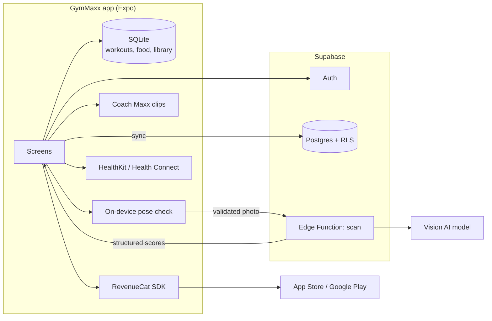

# GymMaxx — Project

> Thai-first physique app for men: scan your upper body, find your weak spot, follow a plan, see yourself change.
> Status: **Pre-build (design & planning)** · Last updated: 2026-10-22

## Documents

| File | What it covers |
|---|---|
| [PRD.md](PRD.md) | Problem, users, goals, features & requirements, metrics, risks, release plan |
| [DESIGN.md](DESIGN.md) | UX/UI: user journey, onboarding, IA, key flows, visual system, copy |
| PROJECT.md | This file: tech stack, architecture, repo layout, roadmap, conventions |

## At a glance

| | |
|---|---|
| Platforms | iOS + Android (one codebase) |
| Market | Thailand · Thai default, English toggle |
| Users | Thai men — skinny beginners (Bulk) and people losing weight (Shred) |
| Core loop | Scan → score → weakest zone → Train it → workouts + food → re-scan weekly |
| Business model | Freemium subscription (free score, Pro plan) |
| Inspiration | AbMaxx (scan/score loop), Fitbod (plans, equipment), Ladder (coached programs) |

## Tech stack (proposed)

| Layer | Choice | Why |
|---|---|---|
| App | **Expo (React Native) + TypeScript**, Expo Router | One codebase for iOS + Android, fast iteration, OTA updates |
| UI | Custom components on design tokens from DESIGN.md; React Native Reanimated; react-native-svg (muscle map) | Matches the dark premium design, smooth score/scan animations |
| Fonts | Kanit, IBM Plex Sans Thai, Barlow Condensed (Google Fonts) | Full Thai support, free |
| Local data | SQLite (expo-sqlite) | Offline workouts, library and food log |
| Backend | **Supabase** — Auth, Postgres (RLS), Storage, Edge Functions | Managed, quick to build, row-level security for user data |
| Physique scan | On-device pose detection (photo validation, proportions) + cloud vision AI via an Edge Function returning structured JSON | Consistency + cost control; photo deleted after analysis |
| Coach voice | Pre-generated Thai TTS clips bundled with the app | Works offline, consistent voice |
| Payments | RevenueCat (App Store + Google Play) | One subscription API for both stores |
| Health | Apple HealthKit, Android Health Connect | Sync workouts and weight |
| Analytics | Product analytics (e.g. PostHog) + crash reporting (e.g. Sentry) | Funnel metrics from PRD §5 |
| Exercise data | free-exercise-db (public domain) curated to ~150 exercises, translated to Thai | Free, licence-safe |

## Architecture



Photo handling: the photo is uploaded to the scan function over TLS, analysed, and deleted server-side; only scores and the on-device copy remain.

## Data model (first pass)

| Table | Key fields |
|---|---|
| `profiles` | user_id, goal_mode (shred/bulk/both), sex, birth_year, height_cm, experience, location, equipment[], days_per_week, session_min, language |
| `body_logs` | user_id, date, weight_kg, waist_cm |
| `scans` | user_id, created_at, overall, potential, body_type, body_fat_min, body_fat_max, zones (jsonb), weakest_zone |
| `exercises` | id, name_th, name_en, primary_muscles[], secondary_muscles[], equipment[], level, steps_th[], cues_th[], media[] |
| `plans` | user_id, week_start, days (jsonb) |
| `workouts` | user_id, started_at, finished_at, plan_day, summary (jsonb) |
| `workout_sets` | workout_id, exercise_id, set_no, weight_kg, reps, is_pr |
| `foods` | id, name_th, name_en, kcal, protein_g, carbs_g, fat_g, portions (jsonb) |
| `food_logs` | user_id, date, food_id, portion, multiplier, kcal, macros |

## Planned repo layout

```
gymmaxx/
├── PRD.md · DESIGN.md · PROJECT.md
├── app/                 # Expo Router screens
│   ├── (onboarding)/
│   ├── (tabs)/          # plan, food, home, scan, me
│   └── workout/
├── src/
│   ├── components/      # Button, Card, ScoreRing, MuscleMap, SetRow, ...
│   ├── theme/           # tokens from DESIGN.md §10
│   ├── features/        # scan, plan, workout, nutrition, paywall
│   ├── lib/             # supabase, revenuecat, health, analytics
│   ├── data/            # exercises.json, foods.json (seed)
│   └── i18n/            # th.json, en.json
├── assets/              # fonts, coach audio, exercise media
└── supabase/
    ├── migrations/
    └── functions/scan/
```

## Roadmap

| Phase | Focus | Deliverables | Est. |
|---|---|---|---|
| **0 · Validate** | Demand | 10–20 Thai TikTok slideshows (Bulk vs Shred angles), waitlist page | 2 wks |
| **1 · Prototype** | UX | Clickable Thai prototype; 10 user tests (5 Bulk, 5 Shred) | 2 wks |
| **2 · MVP** | Build P0 | Onboarding, scan, plan, workout player, library, nutrition, paywall | 8–10 wks |
| **3 · Beta** | Quality | TestFlight + Play closed test (~100 users), pricing test, scan consistency tuning | 3–4 wks |
| **4 · Launch** | Thailand | Store launch, creator partnership, weekly metrics review | — |
| **Later** | Growth | Coach voice polish, share cards, Health sync, women's version, scan-the-machine, form check | — |

### MVP build order (Phase 2)

1. Project setup: Expo, TypeScript, theme tokens, fonts, i18n, navigation shell (5 tabs).
2. Exercise library from free-exercise-db (Thai translation, muscle map, demo loops).
3. Onboarding + calorie/protein calculator + plan generator.
4. Workout player (logging, background rest timer, keep-awake, swap, summary).
5. Nutrition (Thai foods, portion picker, rings).
6. Supabase auth + sync.
7. Body scan (camera, pose check, scan function, result, progress compare).
8. Paywall (RevenueCat) and free/Pro gating.
9. Notifications, streaks, analytics, crash reporting.

## Conventions

- **Language:** all user-facing strings go through i18n (`th.json` first, `en.json` second) — no hard-coded text.
- **Design:** colours, fonts and spacing only from theme tokens (DESIGN.md §10).
- **Content rules:** every exercise must have a demo; every food must have portions.
- **Pricing rules:** any discount is calculated against a price shown on screen (PRD F8.5).
- **Privacy:** never log or persist body photos server-side.
- **Git:** small commits with clear messages; feature branches; PRs for review.

## Team & ownership

| Role | Owner |
|---|---|
| Product / founder | GymMaxx founder |
| Design | TBD |
| Mobile engineering | TBD |
| Content (Thai exercise + food data, trainer review) | TBD |
| Growth (TikTok, creator partnership) | TBD |
